# Fullwave 2.5

**Ultrasound wave propagation simulation with heterogeneous power-law attenuation**

<a href="https://doi.org/10.5281/zenodo.17625780"></a>
<a href="https://pypi.org/project/fullwave25/"></a>
<a href="https://pepy.tech/projects/fullwave25"></a>
<a href="LICENSE"></a>
[](https://colab.research.google.com/github/pinton-lab/fullwave25/blob/main/examples/simple_plane_wave/example_simple_plane_wave.ipynb)

Fullwave 2.5 simulates nonlinear ultrasound propagation in tissue whose attenuation follows a power law $\alpha_0 f^\gamma$ **with a coefficient $\alpha_0$ and an exponent $\gamma$ that can differ in every grid cell**, together with the dispersion that the Kramers-Kronig relations give for each cell. It runs 2D and 3D simulations on multiple GPUs from a Python interface.

<p align="center">
  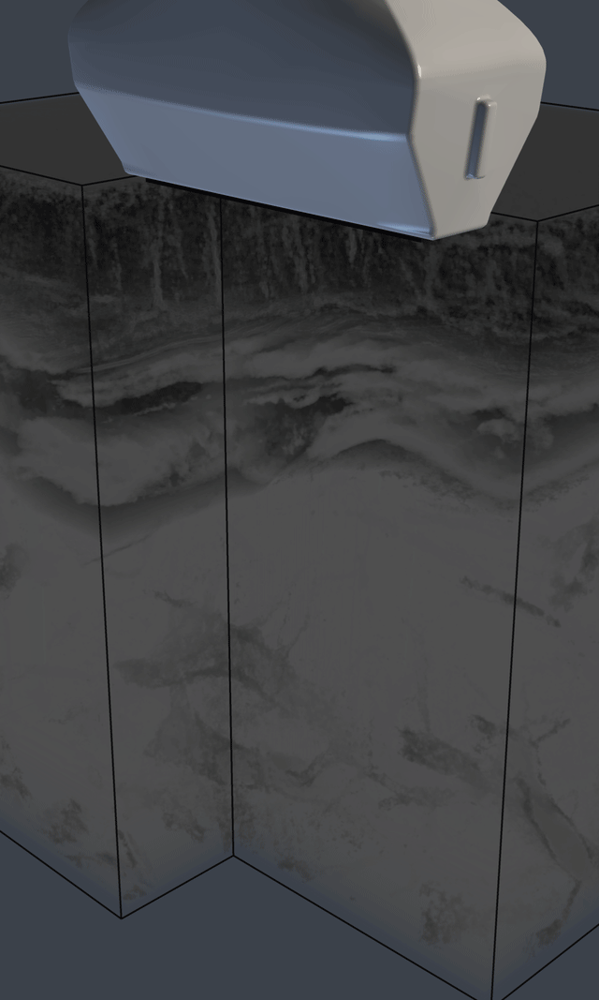
</p>
<p align="center"><em>3D simulation of a focused transmit from an L7-4 linear array through an abdominal wall. L7-4 CAD model: <a href="https://grabcad.com/library/ultrasound-probes-1">Ultrasound probes</a> by Amirhasan Qadamian (GrabCAD).</em></p>

| Medium: abdominal wall and liver (2D)    | Focused transmit from an L7-4 array                                        |
| ---------------------------------------- | -------------------------------------------------------------------------- |
| 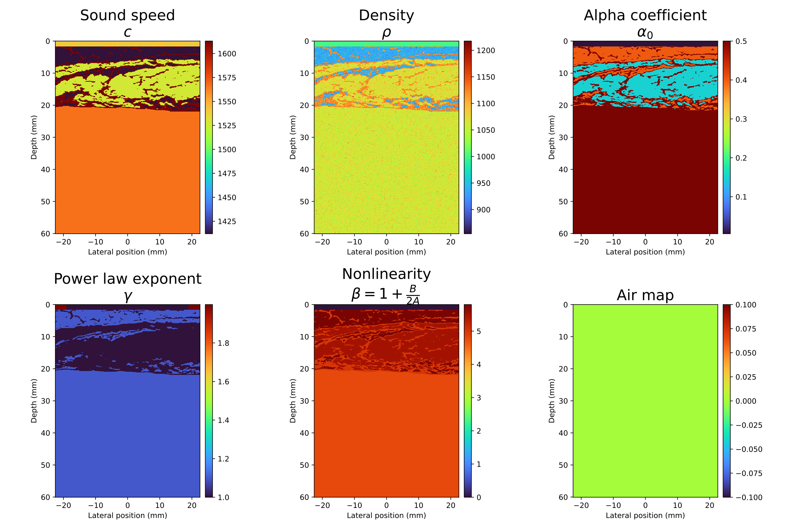 | 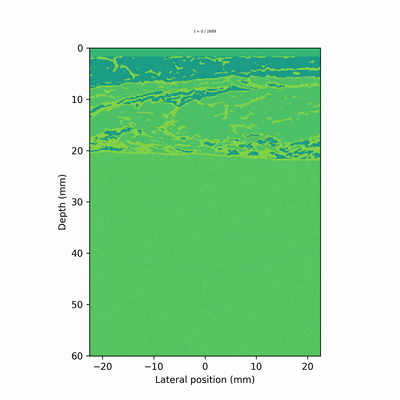 |

## Highlights

- **Heterogeneous power-law attenuation.** Multiple relaxation processes give the attenuation and the dispersion of $\alpha_0 f^\gamma$ for a map of $\alpha_0$ and a map of $\gamma$.
- **High-order FDTD.** Staggered-grid pressure-velocity scheme, 8th order in space and 4th order in time, with a relaxing perfectly matched layer.
- **2D and 3D, multi-GPU.** The 3D domain is split along depth across GPUs.
- **Transducers ready to use.** L7-4 linear, C5-2V curved and P4-1C phased arrays, or any geometry, with plane wave, focused, diverging and synthetic aperture transmits.
- **Transmit batches.** Several transmits on one medium run in one simulation.
- **Beamforming.** A delay-and-sum `Beamformer` on the CPU, and `MachBeamformer` on the GPU, built on [mach](https://github.com/Forest-Neurotech/mach).
- **Familiar interface.** The workflow follows [k-Wave](http://www.k-wave.org/) and [k-wave-python](https://github.com/waltsims/k-wave-python).

## Attenuation model

The solver advances the pressure $p$ and the particle velocity $\mathbf{v}$ with

$$\nabla_1 p + \rho \cfrac{\partial {\bf{v}}}{\partial t} = 0, \qquad \nabla_2 \cdot {\bf{v}} + \kappa \cfrac{\partial p}{\partial t} = 0 .$$

in which the spatial derivatives $\nabla_1$ and $\nabla_2$ carry a set of relaxation mechanisms. fullwave25 looks up the parameters of these mechanisms in a precomputed table for the $\alpha_0$ and $\gamma$ of each cell, so that the simulated attenuation matches the power law and the phase velocity matches its Kramers-Kronig dispersion. The table spans $\alpha_0$ up to 1.0 dB/(MHz^γ cm) and $\gamma$ from 0.4 to 2.0, for frequencies from 0.1 to 20 MHz.

The figure compares the target attenuation $\alpha_0 f^\gamma$ (red lines) with the simulated attenuation (black dots) for $\alpha_0 =$ 0.25, 0.5 and 0.75 dB/(MHz^γ cm) and $\gamma =$ 0.4, 0.7, 1.0, 1.3 and 1.6. Each dot is one simulation of a plane wave through a uniform medium, read at two depths.

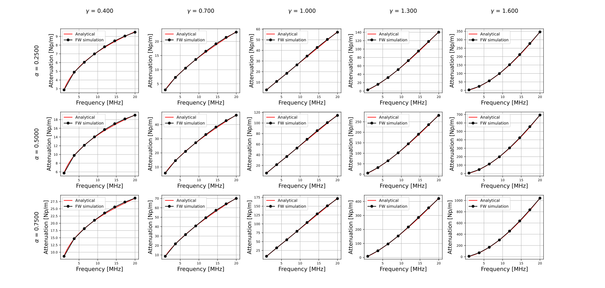

[attenuation_dispersion.py](examples/attenuation_dispersion/attenuation_dispersion.py) makes these measurements, so you can check the model for your own parameters.

## Installation

Requirements: Linux (on Windows, use [WSL2](https://learn.microsoft.com/en-us/windows/wsl/install)) and an NVIDIA GPU. A 3D simulation can need several GPUs.

```sh
pip install fullwave25
pip install "fullwave25[mach]"  # optional: MachBeamformer (mach-beamform, pymust, cupy)
```

The released solver binaries need glibc 2.34 or newer (for example Ubuntu 22.04). On an older system, use the container in [docker/README.md](docker/README.md).

The plotting functions write videos with `ffmpeg` and OpenCV (`cv2`). If they are missing, install them with your package manager:

```sh
sudo apt install ffmpeg python3-opencv  # Ubuntu/Debian; or: pip install opencv-python
```

### Development installation

We use [uv](https://docs.astral.sh/uv/) to manage the environment.

```sh
curl -LsSf https://astral.sh/uv/install.sh | sh  # if uv is not installed
git clone git@github.com:pinton-lab/fullwave25.git
cd fullwave25
make install-all-extras  # core library, examples and development tools
make test
```

## Quick start

Start with the notebook [example_simple_plane_wave.ipynb](examples/simple_plane_wave/example_simple_plane_wave.ipynb), or run it in Google Colab without a local GPU: [](https://colab.research.google.com/github/pinton-lab/fullwave25/blob/main/examples/simple_plane_wave/example_simple_plane_wave.ipynb)

A simulation has five steps:

1. Define the computational grid (`fullwave.Grid`).
2. Define the acoustic medium (`fullwave.Medium`): sound speed, density, attenuation coefficient and exponent, nonlinearity.
3. Define the source (`fullwave.Source`) or a transducer (`fullwave.Transducer`).
4. Define the sensor (`fullwave.Sensor`).
5. Run the solver (`fullwave.Solver`).

To start your own simulation, copy [simple_plane_wave.py](examples/simple_plane_wave/simple_plane_wave.py) (2D) or [simple_plane_wave_3d.py](examples/wave_3d/simple_plane_wave_3d.py) (3D) and change it.

### Simulation guide

[.claude/skills/fullwave25/SKILL.md](.claude/skills/fullwave25/SKILL.md) is a short guide to setting up a simulation the standard way. It covers:

- the basic flow, the output shapes and the sensor order;
- scatterers, air and the discretized attenuation values;
- grid resolution, duration, the size of the record and running in memory;
- transducers, presets and beamforming;
- multi-GPU runs, the container and troubleshooting.

Read it before writing a new simulation. The same file is a [Claude Code](https://docs.anthropic.com/en/docs/claude-code) skill: Claude Code loads it in a clone of this repository, and you can copy the folder to `~/.claude/skills/fullwave25/` to use it in your own projects.

## Transducers and transmits

A named array places itself on the grid, and one call sets the transmit.

```python
grid = fullwave.Grid(domain_size=(4.5e-2, 4.5e-2), f0=5.208e6, duration=6.7e-5, c0=1540)

transducer = fullwave.Transducer.l7_4(grid)
transducer.plane_wave(angle_deg=2.5)
maps = transducer.fill_probe_above_face(
    sound_speed=sound_speed_map, density=density_map, alpha_coeff=alpha_coeff_map, alpha_power=alpha_power_map,
)
medium = fullwave.Medium(grid, beta=beta_map, **maps)

solver = fullwave.Solver(work_dir="./outputs/my_run", grid=grid, medium=medium, transducer=transducer)
sensor_output = solver.run()  # [n_elements, n_t]
```

| Array   | Type          | Elements | Aperture                        | Center frequency |
| ------- | ------------- | -------- | ------------------------------- | ---------------- |
| `l7_4`  | linear        | 128      | 38.09 mm                        | 5.208 MHz        |
| `p4_1c` | linear phased | 64       | 27 mm                           | `grid.f0`        |
| `c5_2v` | curved        | 128      | 0.508 mm pitch, 49.57 mm radius | 3.7 MHz          |

`fullwave.TransducerGeometry` builds any other array. The transmits are `plane_wave(angle_deg=...)`, `focus(focus_m=...)`, `diverging(virtual_source_m=...)` and `synthetic_aperture(element)`; each takes `apodization` and `pulse`. To transmit with part of the aperture, set `transducer.active_source_elements` first.

### Linear array layout

The linear arrays (`l7_4`, `p4_1c` and `LinearTransducer`) share one layout, from the top of the grid:

| Rows                          | Content                                                                                   |
| ----------------------------- | ----------------------------------------------------------------------------------------- |
| from row 0                    | source: one wavelength of rows (at least 8), with the absorbing layer directly behind it  |
| next row                      | receiver                                                                                  |
| `transducer.face_row_px`      | probe face, depth 0 (`transducer.face_depth_m`): the medium starts here                   |

The array is centered laterally, so make the grid wider than the array (for example 45 mm for the 38.09 mm L7-4). `transducer.fill_probe_above_face(...)` sets the rows above the face to a probe fill (1540 m/s, 1000 kg/m³, 0.005 dB/(MHz cm), power 1.0) across the array and to water beside it, without scatterers. Pass its result to `fullwave.Medium`, or register `transducer.probe_fill_domain()` last in a `MediumBuilder`.

`Transducer.l7_4` gives every gap between two elements exactly one pixel (`kerf_px=1`) and holds those kerf pixels at zero pressure after the drive (`hold_kerf=True`); `kerf_px=None, hold_kerf=False` gives an array without held kerfs. A held kerf needs `source_type="hard"`.

Start the tissue at the face (for an `AbdominalWallDomain`, pass `start_depth=transducer.face_depth_m`) and measure target and focus depths from it. The curved `c5_2v` keeps its own layout; `transducer.make_surface_reflective_with_air()` returns the air behind it. `transducer.apply_transducer_stack(...)` paints a backing, a matching layer, a lens and a standoff (`fullwave.TransducerStack`) onto the medium maps before the `Medium` is built.

### Source types

| `source_type`           | Behavior                                                                                                   |
| ----------------------- | ---------------------------------------------------------------------------------------------------------- |
| `"hard"` (named arrays) | assigns the source pressure for the whole run; after the drive ends the source cells stay at 0 Pa, so the face reflects |
| `"hard_released_after"` | assigns the source pressure while the drive plays; then the source cells evolve freely                    |
| `"soft"`                | adds the signal to the field                                                                               |

Pass `source_type=` to `Transducer.l7_4`, `c5_2v`, `p4_1c` or `fullwave.Solver`.

### Transmit batches

A transmit sequence on one medium, such as plane wave angles, focused lines or synthetic aperture elements, can run as a batch: several transmits in one simulation, which is faster than one `run` per transmit. The transmits of a batch share the medium, the sensor and the source positions, and differ only in their signals; the transmits of one transducer satisfy this.

```python
sources = []
for angle in (-10, -5, 0, 5, 10):
    transducer.plane_wave(angle_deg=angle)
    sources.append(transducer.source)

sensor_output = solver.run_batch(sources)  # [n_transmits, n_sensors, n_t]
```

`run_batch` puts at most `max_members_per_run` transmits in one simulation: 32 by default, or fewer when the estimated GPU memory does not fit. A longer sequence runs as several simulations of nearly equal size, so 128 transmits run as 4 simulations of 32. In a 2D L7-4 test the time per transmit stopped falling at 16 to 32 transmits per simulation.

### Beamforming

| Beamformer                               | Runs on | Purpose                                                       |
| ---------------------------------------- | ------- | ------------------------------------------------------------- |
| `fullwave.beamformer.Beamformer`         | CPU     | delay-and-sum for linear arrays, for teaching; not optimized for speed |
| `fullwave.beamformer.MachBeamformer`     | GPU     | fast delay-and-sum with [mach](https://github.com/Forest-Neurotech/mach) |

mach is an open-source GPU beamformer with an optimized delay-and-sum CUDA kernel: 1.1 trillion points per second on a consumer GPU, more than 10 times faster than other open-source GPU beamformers. `pip install "fullwave25[mach]"` installs mach-beamform, pymust and cupy; mach needs Linux and an NVIDIA driver for CUDA 12.8 or newer.

```python
beamformer = MachBeamformer.from_transducer(
    transducer, lateral_position_m=lateral_m, axial_position_m=depth_m, f_number=1.0,
)
arrival_s = [beamformer.plane_wave_arrival_s(angle_deg=a) for a in angles]
image = beamformer.beamform(np.stack(traces), tx_arrival_s=np.stack(arrival_s))  # complex [n_depth, n_lateral]
```

`MachBeamformer` converts the traces to IQ with `pymust.rf2iq` and measures depth from the probe face. `traces` holds one `[n_elements, n_t]` array per transmit (from `post_process_sensor_output`). `focused_arrival_s(focus_m=...)` and `synthetic_aperture_arrival_s(element=...)` give the other transmits. Time zero follows from the drive and the rows between the source and the face, so it holds for every transmit of the named linear arrays. `f_number` is depth / aperture width; `Beamformer` takes the half width as depth / F, so pass `f_number / 2` to it for the same aperture. If you use `MachBeamformer`, please also cite mach (see [Citation](#citation)).

### Imaging a phantom

`fullwave.presets.CombinedPhantomDomain` builds an imaging phantom: point targets in a column and in rows, and hypoechoic and hyperechoic cylinders, on a scattering background. [plane_wave_phantom.py](examples/linear_transducer/plane_wave_phantom.py) sends one plane wave from an L7-4 array at 5.208 MHz through it and beamforms the echoes into a B-mode with `MachBeamformer`.

| Plane wave through the phantom                         | B-mode, one plane wave (0 to −40 dB)                          |
| ------------------------------------------------------ | ------------------------------------------------------------- |
| 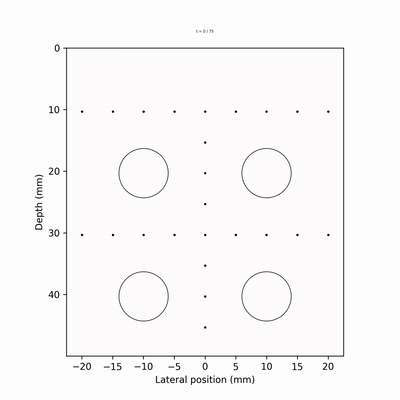   | 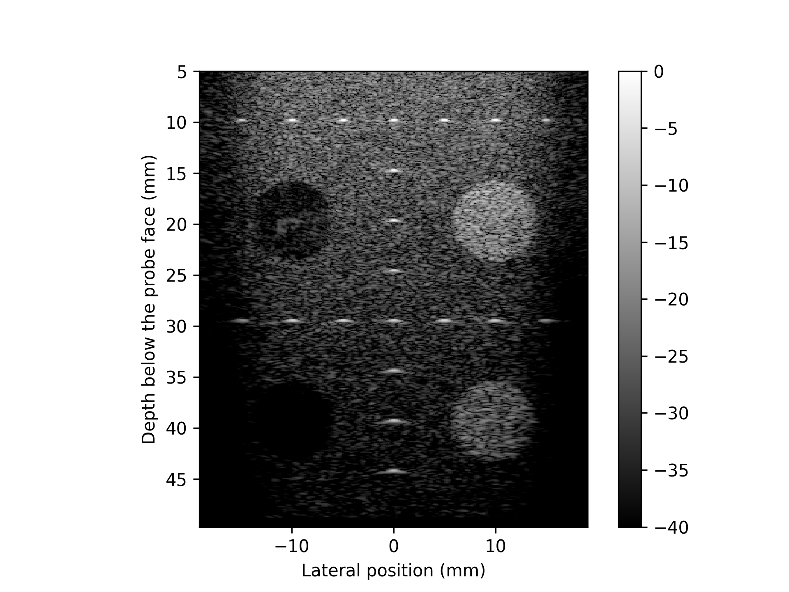   |

## Examples

| Task | Example | Notebook / Colab |
| --- | --- | --- |
| 2D plane wave from a source built by hand, through an inclusion | [simple_plane_wave.py](examples/simple_plane_wave/simple_plane_wave.py) | [notebook](examples/simple_plane_wave/example_simple_plane_wave.ipynb), [](https://colab.research.google.com/github/pinton-lab/fullwave25/blob/main/examples/simple_plane_wave/example_simple_plane_wave.ipynb) |
| 2D plane wave through an inclusion with scattered air cells | [simple_plane_wave_air.py](examples/simple_plane_wave/simple_plane_wave_air.py) | [notebook](examples/simple_plane_wave/example_simple_plane_wave_air.ipynb), [](https://colab.research.google.com/github/pinton-lab/fullwave25/blob/main/examples/simple_plane_wave/example_simple_plane_wave_air.ipynb) |
| Attenuation and phase velocity of a uniform medium against the power law | [attenuation_dispersion.py](examples/attenuation_dispersion/attenuation_dispersion.py) | |
| Layered medium built with `MediumBuilder` | [medium_builder_example.py](examples/medium_builder/medium_builder_example.py) | [notebook](examples/medium_builder/medium_builder_example.ipynb), [](https://colab.research.google.com/github/pinton-lab/fullwave25/blob/main/examples/medium_builder/medium_builder_example.ipynb) |
| Abdominal wall built with `MediumBuilder` | [medium_builder_abdominal_example.py](examples/medium_builder/medium_builder_abdominal_example.py) | |
| L7-4 linear array: focused transmit through an abdominal wall | [linear_transducer_abdominal_wall.py](examples/linear_transducer/linear_transducer_abdominal_wall.py) | |
| L7-4 linear array: plane wave compounding B-mode | [plane_wave_compounding.py](examples/linear_transducer/plane_wave_compounding.py) | [notebook](examples/linear_transducer/plane_wave_compounding.ipynb), [](https://colab.research.google.com/github/pinton-lab/fullwave25/blob/main/examples/linear_transducer/plane_wave_compounding.ipynb) |
| L7-4 linear array: plane wave movie and B-mode of an imaging phantom | [plane_wave_phantom.py](examples/linear_transducer/plane_wave_phantom.py) | |
| L7-4 linear array: plane wave compounding B-mode, all angles in one transmit batch | [plane_wave_compounding_batch.py](examples/linear_transducer/plane_wave_compounding_batch.py) | |
| L7-4 linear array: plane waves and focused lines as transmit batches | [transmit_batch_basics.py](examples/transmit_batch/transmit_batch_basics.py) | |
| L7-4 linear array: full synthetic aperture B-mode | [full_synthetic_aperture.py](examples/linear_transducer/full_synthetic_aperture.py) | [notebook](examples/linear_transducer/full_synthetic_aperture.ipynb), [](https://colab.research.google.com/github/pinton-lab/fullwave25/blob/main/examples/linear_transducer/full_synthetic_aperture.ipynb) |
| L7-4 linear array: high-pass filter on the recorded traces | [plane_wave_with_filter.py](examples/signal_filter/plane_wave_with_filter.py) | |
| P4-1C phased array: focused transmit from half the aperture, with a movie of the field | [linear_transducer_focused_animation.py](examples/linear_transducer/linear_transducer_focused_animation.py) | |
| C5-2V curved array: full synthetic aperture acquisition | [convex_transducer_fsa.py](examples/convex_transducer/convex_transducer_fsa.py) | |
| C5-2V curved array: focused transmit through an abdominal wall | [convex_transducer_abdominal_wall.py](examples/convex_transducer/convex_transducer_abdominal_wall.py) | |
| 3D plane wave through an inclusion | [simple_plane_wave_3d.py](examples/wave_3d/simple_plane_wave_3d.py) | |
| 3D plane wave through an inclusion with scattered air cells | [simple_plane_wave_3d_with_air.py](examples/wave_3d/simple_plane_wave_3d_with_air.py) | |

### Gallery

| Plane wave through an inclusion                   | P4-1C focused transmit                                 | C5-2V through an abdominal wall                                 |
| ------------------------------------------------- | ------------------------------------------------------ | --------------------------------------------------------------- |
| 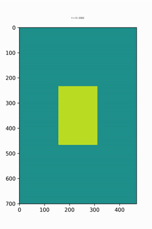 | 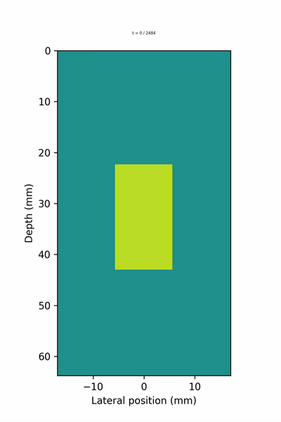 | 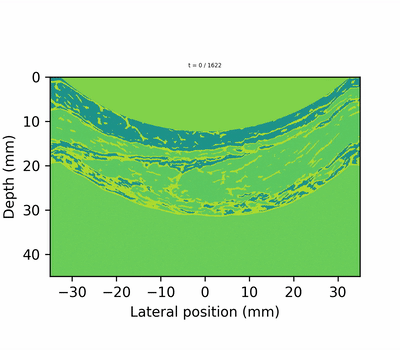 |

**3D plane wave through an inclusion, without and with scattered air cells**

|             | x-y slice                                                  | x-z slice                                                  |
| ----------- | ---------------------------------------------------------- | ---------------------------------------------------------- |
| without air cells | 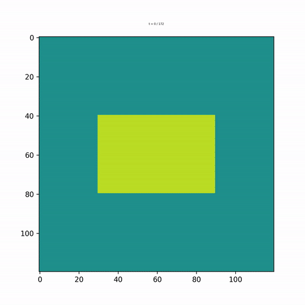     | 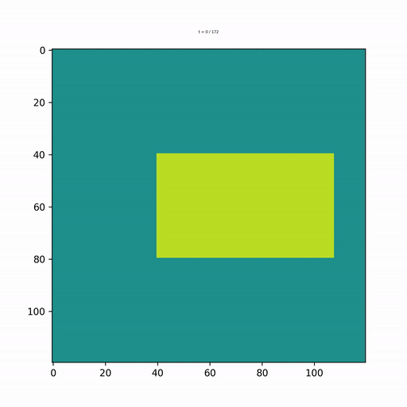     |
| with air cells    | 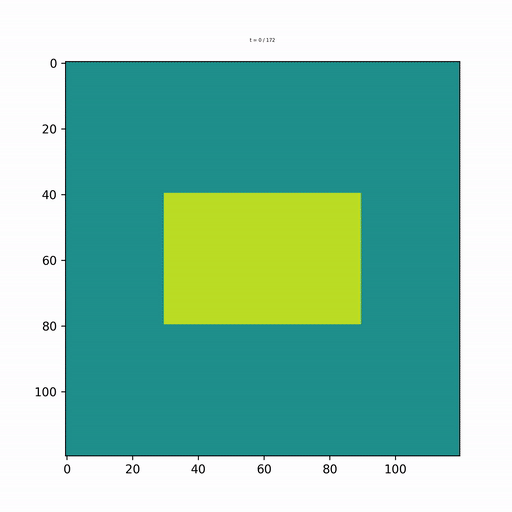 | 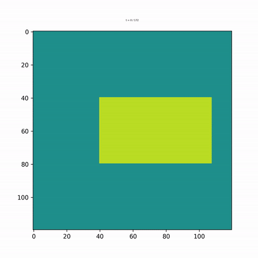 |

## Experimental: fullwave2-ultra backend

`Solver(..., use_ultra=True)` runs the simulation with the fullwave2-ultra binary, which is optimized for speed. It is experimental, its API may change, and the binaries are not part of fullwave25. See [docs/fullwave2_ultra.md](docs/fullwave2_ultra.md).

## Notes

- **Axis order.** The grid axes are (x, y, z) = (depth, lateral, elevation). The solver splits the domain along depth across GPUs, so depth comes first.
- **Index order.** Source and sensor coordinates are in C (row-major) order inside the solver, whatever order you use. Check this when you build a source by hand.
- **GPU memory.** A 3D simulation needs much GPU memory. Reduce the grid or use more GPUs if it does not fit; `nvidia-smi` or `nvtop` shows the use. `Solver.run` estimates the memory before the run (`gpu_memory_estimate=True`, the default).
- **Multi-GPU.** 2D and 3D runs can use multiple GPUs (`cuda_device_id`); the run time scales linearly with the number of GPUs.
- **3D.** Start with the 2D version of a simulation. The 3D code is similar, runs longer, and some plot functions are 2D only.

## Citation

Fullwave 2.5 is developed and maintained by the [Pinton Lab](https://github.com/pinton-lab) at the University of North Carolina at Chapel Hill. If you use Fullwave 2.5 in your research, please cite:

```bibtex
@article{Sode2026-heterogeneous-attenuation,
  title         = {Spatially heterogeneous power-law attenuation with multiple relaxation mechanisms for ultrasound modeling},
  author        = {Sode, Masashi and Pinton, Gianmarco},
  journal       = {arXiv preprint arXiv:2606.11103},
  year          = {2026},
  eprint        = {2606.11103},
  archivePrefix = {arXiv},
  primaryClass  = {physics.med-ph},
  url           = {https://arxiv.org/abs/2606.11103}
}

@article{Sode2026-fullwave2,
  title     = {A fullwave model of the nonlinear wave equation with multiple relaxations and relaxing perfectly matched layers for high-order numerical finite difference solutions},
  author    = {Sode, Masashi and Pinton, Gianmarco},
  journal   = {Physics in Medicine \& Biology},
  publisher = {IOP Publishing},
  year      = {2026},
  doi       = {10.1088/1361-6560/ae9116},
  url       = {https://doi.org/10.1088/1361-6560/ae9116}
}

@software{Sode2025-fullwave25,
  title  = {Fullwave 2.5: Ultrasound wave propagation simulation with heterogeneous power law attenuation modelling capabilities},
  author = {Sode, Masashi and Pinton, Gianmarco},
  year   = {2025},
  doi    = {10.5281/zenodo.17497689},
  url    = {https://github.com/pinton-lab/fullwave25}
}
```

If you use `MachBeamformer`, please also cite mach:

```bibtex
@article{mach,
  title     = {mach: ultrafast ultrasound beamforming},
  author    = {Guan, Charles and Rockhill, Alexander P and Sode, Masashi and Pinton, Gianmarco},
  year      = 2026,
  journal   = {Journal of Medical Imaging},
  publisher = {Society of Photo-Optical Instrumentation Engineers},
  volume    = 13,
  number    = 6,
  pages     = {062203--062203},
  doi       = {10.1117/1.JMI.13.6.062203},
  url       = {https://github.com/Forest-Neurotech/mach}
}
```

## Contributing

Contributions are welcome. Please read [CONTRIBUTING.md](CONTRIBUTING.md) for the branch names, the pull request flow and the code checks.

## Acknowledgments

The design of this repository was inspired by [k-wave-python](https://github.com/waltsims/k-wave-python). We thank the k-wave-python developers; their tools have contributed much to the ultrasound research community.

## Authors

- Masashi Sode ([MasashiSode](https://github.com/MasashiSode)), maintainer
- Gianmarco Pinton ([gfpinton](https://github.com/gfpinton))
