# Fullwave 2.5: Ultrasound wave propagation simulation with heterogeneous power law attenuation modelling capabilities

<a href="https://doi.org/10.5281/zenodo.17625780"></a>
<a href="https://pepy.tech/projects/fullwave25"></a>

[](https://colab.research.google.com/drive/153Sx9D_5zTlF7UtlKHlyz_CTJnLIAI6s)

Fullwave 2.5 is a Python package for high-fidelity ultrasound wave propagation simulation with the following features:

- State-of-the-art attenuation modelling capabilities for ultrasound wave propagation in complex biological tissues
  - Heterogeneous power law attenuation ($\alpha=\alpha_0 f^\gamma$) modeling, where **both the attenuation coefficient $\alpha_0$ and exponent $\gamma$ can vary** spatially.
- High-performance simulation engine
  - High accuracy staggered-grid finite-difference time-domain (FDTD) scheme (8th-order in space and 4th-order in time).
  - 2D and 3D ultrasound wave propagation simulation.
  - Multiple GPU execution support.
- Easy-to-use Python interface with CUDA/C backend
  - Python wrapper for easy usability and extensibility, with the core simulation engine implemented in CUDA/C for high performance on NVIDIA GPUs.
  - It offers a user experience similar to [k-Wave](http://www.k-wave.org/) and [k-wave-python](https://github.com/waltsims/k-wave-python), while providing advanced attenuation modeling capabilities and multi-GPU support in FDTD simulations.

| Computational medium                     | Wave propagation                                                           |
| ---------------------------------------- | -------------------------------------------------------------------------- |
| 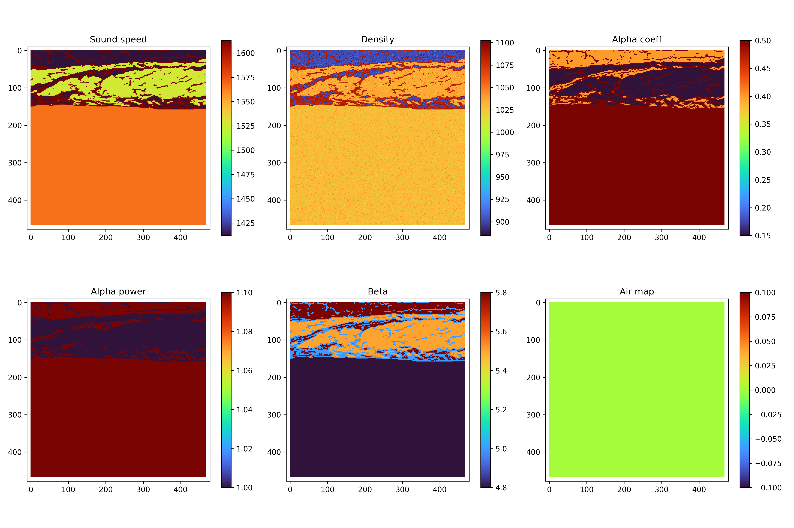 | 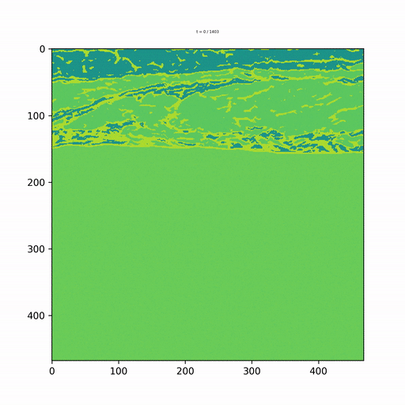 |

Building upon the original Fullwave 2 simulator, Fullwave 2.5 enhances its capabilities to model ultrasound wave propagation in media where **both the attenuation coefficient and exponent can vary spatially**. This enables more accurate simulations of biological tissues, which often exhibit complex attenuation behaviours that cannot be captured by uniform exponent models.

The library is designed with a Python wrapper for ease of use and extensibility, while the core simulation engine is implemented in CUDA/C to leverage high-performance computing on NVIDIA GPUs. Fullwave 2.5 supports 2D and 3D simulations, including multi-GPU execution for enhanced performance.

## Special Thanks

This repository design was inspired by [k-wave-python](https://github.com/waltsims/k-wave-python). We appreciate the great work of the k-wave-python development team.
This repository would not have been possible without them.

Please check their repository for additional ultrasound simulation tools and resources.
Their comprehensive tools have significantly contributed to the ultrasound research community.

## Theoretical Background

Fullwave 2.5 models multiple relaxation processes to approximate frequency-dependent power-law attenuation in heterogeneous media.
It solves the stretched-coordinate pressure-velocity formulation using a staggered-grid finite-difference schemes with 8th-order accuracy in space and 4th-order accuracy in time.
The formulation is expressed as follows:

$$\nabla_1 p + \rho \cfrac{\partial {\bf{v}}}{\partial t} = 0$$
$$\nabla_2 \cdot {\bf{v}} + \kappa \cfrac{\partial p}{\partial t} = 0$$

The stretched-coordinate derivatives, denoted by $\nabla_1$ and $\nabla_2$, control frequency-dependent power-law attenuation and dispersion by selecting the optimal relaxation parameters.

The following figure illustrates the performance of the attenuation modeling in Fullwave 2.5.
The graph shows a comparison of the target power-law attenuation $\alpha=\alpha_0 f^\gamma$ (red line) and the simulated attenuation (black dots) for various spatially varying attenuation coefficients ($\alpha_0 =$ 0.25, 0.5, and 0.75) and exponents ($\gamma =$ 0.4, 0.7, 1.0, 1.3, and 1.6).

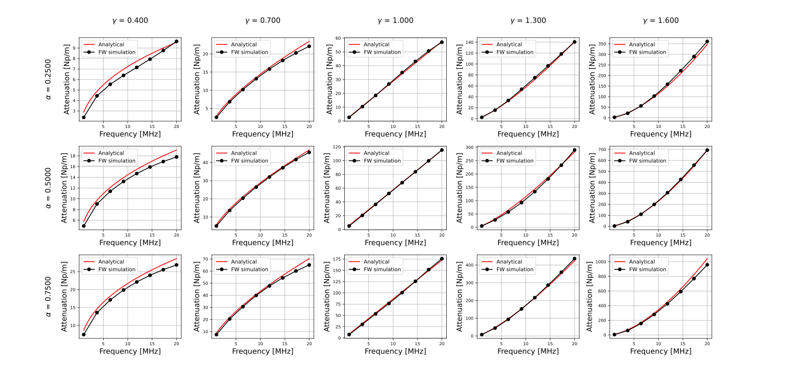

## Citation

Fullwave 2.5 is developed and maintained by [Pinton Lab](https://github.com/pinton-lab) at the University of North Carolina at Chapel Hill.

If you use Fullwave 2.5 in your research, please cite this repository as:

```bibtex
@ARTICLE{Sode2026-rd,
  title        = {Spatially heterogeneous power-law attenuation with multiple
                  relaxation mechanisms for ultrasound modeling},
  author       = {Sode, Masashi and Pinton, Gianmarco},
  journaltitle = {arXiv [physics.med-ph]},
  date         = {2026},
  eprint       = {2606.11103},
  eprinttype   = {arXiv},
  eprintclass  = {physics.med-ph},
  url          = {http://arxiv.org/abs/2606.11103},
}

@ARTICLE{Sode2026-fullwave2,
  title     = "{A fullwave model of the nonlinear wave equation with multiple
               relaxations and relaxing perfectly matched layers for high-order
               numerical finite difference solutions}",
  author    = "Sode, Masashi and Pinton, Gianmarco",
  journal   = "Phys. Med. Biol.",
  publisher = "IOP Publishing",
  month     =  "27~" # jul,
  year      =  2026,
  url       = "http://dx.doi.org/10.1088/1361-6560/ae9116",
  doi       = "10.1088/1361-6560/ae9116",
  issn      = "0031-9155,1361-6560",
  language  = "en"
}


@software{Sode2025-fullwave25,
  author = {Sode, Masashi and Pinton, Gianmarco},
  title = {{Fullwave 2.5: Ultrasound wave propagation simulation with heterogeneous power law attenuation modelling capabilities}},
  year = {2025},
  month = oct,
  doi = {10.5281/zenodo.17497689},
  url = {https://github.com/pinton-lab/fullwave25},
}

```

---

## Hardware prerequisites

- This system operates in a Linux environment.
  - If you need a Windows environment, please consider using [WSL2](https://learn.microsoft.com/en-us/windows/wsl/install) (Windows Subsystem for Linux 2).
- This simulation requires an NVIDIA GPU to execute.
- You may need multiple GPUs for 3D simulation.

## Technical recommendations

- We recommend setting up an SSH key for GitHub, if you haven't done already. The repository changes over time to fix bugs and add new features. You can keep your local repository up to date by pulling the latest changes from GitHub. Cloning through SSH is more convenient than HTTPS in the long run.
  - for ssh key generation
    - please see: [Generating a new SSH key and adding it to the ssh-agent](https://docs.github.com/en/authentication/connecting-to-github-with-ssh/generating-a-new-ssh-key-and-adding-it-to-the-ssh-agent)
  - for ssh key registration to your github account
    - please see: [Adding a new SSH key to your GitHub account](https://docs.github.com/en/authentication/connecting-to-github-with-ssh/adding-a-new-ssh-key-to-your-github-account)
- after that, you can clone the repository through

  ```sh
  git clone git@github.com:pinton-lab/fullwave-python.git
  ```

## Technical references

- If you are not familiar with the tools below, please refer to the provided links.
  - VSCode
    - [Official Visual Studio Code documentation](https://code.visualstudio.com/docs)
    - [Visual Studio Code Tutorial for Beginners by Udacity](https://www.udacity.com/blog/2025/09/visual-studio-code-tutorial-for-beginners-productivity-tips-and-extensions.html)
  - Git
    - [Git Tutorial by GeeksForGeeks](https://www.geeksforgeeks.org/git/git-tutorial/)
    - [Git Tutorial by W3 schools](https://www.w3schools.com/git/default.asp)
    - [Using Git source control in VS Code](https://code.visualstudio.com/docs/sourcecontrol/overview)
  - UV
    - [Python UV: The Ultimate Guide to the Fastest Python Package Manager](https://www.datacamp.com/tutorial/python-uv)

---

## installation for users

```sh
pip install fullwave25
```

## Troubleshooting

If `ffmpeg` is not installed on your system, please install it using the package manager of your Linux distribution.
`ffmpeg` is used for video writing in plotting functions.

please see the installation guide below.
reference: [FFmpeg Installation Guide](https://ffmpeg.org/download.html)

```sh
# for Ubuntu/Debian
sudo apt install ffmpeg
```

Additionally, if you encounter any issues related to `cv2` (OpenCV) during the installation, please install it separately using linux package manager or pip.

please see the installation guide below.
`cv2` is used fro video writing in plotting functions.

reference: [Installing OpenCV on Linux: A Comprehensive Guide](https://linuxvox.com/blog/install-opencv-linux/)

```sh
# using apt for Ubuntu/Debian
sudo apt install python3-opencv

# using pip
pip install opencv-python
```

## installation for development

We use [uv](https://docs.astral.sh/uv/) for package project and virtual environment management.

If uv is not installed, run below.

```sh
curl -LsSf https://astral.sh/uv/install.sh | sh
```

Run below to install the development environment.

```sh
git clone git@github.com:pinton-lab/fullwave25.git
cd fullwave25
make install-all-extras # for running examples
# or
make install # for the core library installation
```

To test the installation, run

```sh
make test
```

---

## Tutorial: Basic Usage

Please start from [example_simple_plane_wave.ipynb](https://github.com/pinton-lab/fullwave25/blob/main/examples/simple_plane_wave/example_simple_plane_wave.ipynb).

or try the Google Colab tutorial.
You don't need to install or set up a GPU environment on your local machine in order to run the simulation.

[](https://colab.research.google.com/drive/153Sx9D_5zTlF7UtlKHlyz_CTJnLIAI6s)

Here are the main steps to run the Fullwave simulation

1. Define the computational grid.
2. Define the properties of the acoustic medium.
3. Define the acoustic source.
4. Define the sensor.
5. Execute the simulation.

## Tutorial: transducers and transmits

A named array places itself on the grid, and one call states the transmit.

```python
grid = fullwave.Grid(domain_size=(4.5e-2, 4.5e-2), f0=5.208e6, duration=6.7e-5, c0=1540)

transducer = fullwave.Transducer.l7_4(grid)
transducer.plane_wave(angle_deg=2.5)

solver = fullwave.Solver(work_dir="./outputs/my_run", grid=grid, medium=medium, transducer=transducer)
recorded = solver.run()
```

The arrays are `l7_4` (linear, 128 elements, 5.208 MHz), `c5_2v` (curved, 49.57 mm radius, 3.7 MHz) and `p4_1c` (phased, 64 elements). `fullwave.TransducerGeometry` builds any other.

The transmits are `plane_wave(angle_deg=...)`, `focus(focus_m=...)`, `diverging(virtual_source_m=...)` and `synthetic_aperture(element)`. Each takes `apodization` and `pulse`. Set `transducer.active_source_elements` first to use part of the aperture.

The source type is `"hard_released_after"` by default: the transducer assigns its pressure while the drive signal plays, then the source cells evolve freely. `"hard"` assigns it for the whole run, so the cells stay at zero pressure after the drive ends. `"soft"` adds the signal to the field, and is what the calibrated setups use. Pass `source_type=` to `Transducer.l7_4`, `c5_2v`, `p4_1c` or `fullwave.Solver`.

`transducer.apply_transducer_stack(...)` paints a probe's backing, matching layer, lens and standoff onto the medium maps before the `Medium` is built. `fullwave.TransducerStack` holds the values.

### Transmit batches

A transmit sequence on one medium, such as plane wave angles, focused lines or synthetic aperture elements, can run as a batch: several transmits in one simulation, which is faster than one `run` per transmit. The transmits of a batch share the medium, the sensor and the source positions, and differ only in their signals. The transmits of one transducer satisfy this.

```python
sources = []
for angle in (-10, -5, 0, 5, 10):
    transducer.plane_wave(angle_deg=angle)
    sources.append(transducer.source)

solver = fullwave.Solver(
    work_dir="./outputs/my_batch", grid=grid, medium=medium, transducer=transducer,
)
recorded = solver.run_batch(sources)  # [n_transmits, n_sensors, n_t]
```

`run_batch` runs all transmits of the list. It puts at most `max_members_per_run` transmits in one simulation: by default 32, or fewer when the GPU memory estimate does not fit that many into the free GPU memory. A longer sequence runs as several simulations of nearly equal size, so 128 transmits run as 4 simulations of 32. In a 2D L7-4 test the time per transmit stopped falling at 16 to 32 transmits. [transmit_batch_basics.py](examples/transmit_batch/transmit_batch_basics.py) shows plane waves and focused lines as batches, and [plane_wave_compounding_batch.py](examples/linear_transducer/plane_wave_compounding_batch.py) makes a compounded B-mode from one batch.

### Which example to read

| I want to                          | example                                                                                                     |
| ---------------------------------- | ----------------------------------------------------------------------------------------------------------- |
| send one plane wave                | [simple_plane_wave.py](examples/simple_plane_wave/simple_plane_wave.py)                                     |
| do the same in 3D                  | [simple_plane_wave_3d.py](examples/wave_3d/simple_plane_wave_3d.py)                                         |
| compound plane waves into a B-mode | [plane_wave_compounding.py](examples/linear_transducer/plane_wave_compounding.py)                           |
| run a transmit sequence as batches | [transmit_batch_basics.py](examples/transmit_batch/transmit_batch_basics.py)                                |
| compound plane waves in one batch  | [plane_wave_compounding_batch.py](examples/linear_transducer/plane_wave_compounding_batch.py)               |
| focus and watch the beam           | [linear_transducer_focused_animation.py](examples/linear_transducer/linear_transducer_focused_animation.py) |
| run a full synthetic aperture      | [full_synthetic_aperture.py](examples/linear_transducer/full_synthetic_aperture.py)                         |
| do the same on a curved array      | [convex_transducer_fsa.py](examples/convex_transducer/convex_transducer_fsa.py)                             |
| image through an abdominal wall    | [linear_transducer_abdominal_wall.py](examples/linear_transducer/linear_transducer_abdominal_wall.py)       |
| build a layered phantom            | [medium_builder_example.py](examples/medium_builder/medium_builder_example.py)                              |

## New simulation development instruction

- after the [installation](#installation)
- make a directory for your simulation under your favorite path.
  - e.g. `examples/my_simulation/`
- make a `.py` file or copy the example files below to use the boilerplate.
  - 2D plane wave
    - [examples/simple_plane_wave/simple_plane_wave_demo.py](https://github.com/pinton-lab/fullwave25/blob/main/examples/simple_plane_wave/simple_plane_wave.py)
  - 3D plane wave
    - [examples/wave_3d/simple_plane_wave_3d.py](https://github.com/pinton-lab/fullwave25/blob/main/examples/wave_3d/simple_plane_wave_3d.py)
- after that follow [Usage 2D](#tutorial-basic-usage) to define the simulation code.

## Tutorial: Advanced Usages

Please see the following examples for more advanced usage.

- 2D plane wave
  - Basic usage
    - [Simple plane wave](https://github.com/pinton-lab/fullwave25/blob/main/examples/simple_plane_wave/simple_plane_wave.py) [](https://colab.research.google.com/drive/153Sx9D_5zTlF7UtlKHlyz_CTJnLIAI6s)
      - 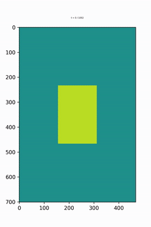
    - [Simple plane wave with air](https://github.com/pinton-lab/fullwave25/blob/main/examples/simple_plane_wave/simple_plane_wave.py) [](https://colab.research.google.com/drive/1AnTaT6ZtwyIEcOvGgpn5srB4LWPfYKh0)
      <!-- - 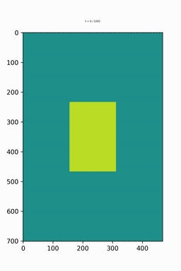 -->
  - Linear transducer
    - [Linear transducer](https://github.com/pinton-lab/fullwave25/blob/main/examples/linear_transducer/linear_transducer.py)
    - [Linear transducer (plane wave transmit) with animation settings](https://github.com/pinton-lab/fullwave25/blob/main/examples/linear_transducer/linear_transducer_animation.py)
      <!-- - 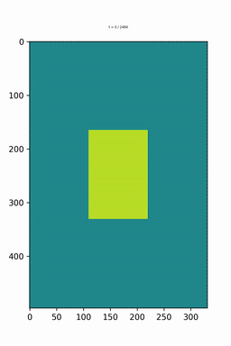 -->
    - [Linear transducer (focused transmit) with animation settings](https://github.com/pinton-lab/fullwave25/blob/main/examples/linear_transducer/linear_transducer_animation.py)
      - 
    - [Linear transducer (focused transmit) with abdominal wall](https://github.com/pinton-lab/fullwave25/blob/main/examples/linear_transducer/linear_transducer.py) [](https://colab.research.google.com/drive/1zlviYe0qBy0JLifFuA2MqUkavJKUQrNb)
      - 
    - linear transducer plane wave compounding
      - [](https://colab.research.google.com/drive/1LXlkpYhIfQtaPhNDJ1vONTDSdiLBhkEP)
    - linear transducer full synthetic aperture
      - [](https://colab.research.google.com/drive/1_jVULK2mglOx8__gWYHGhNVxYLhAGNF5)
  - Convex transducer
    - [Convex transducer with abdominal wall](https://github.com/pinton-lab/fullwave25/blob/main/examples/convex_transducer/convex_transducer_abdominal_wall.py)
      - 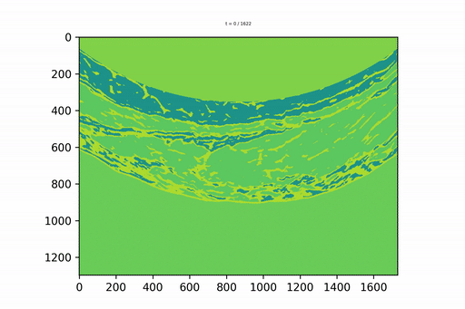
- 3D plane wave
  - Basic usage
    - [Simple plane wave in 3D](https://github.com/pinton-lab/fullwave25/blob/main/examples/wave_3d/simple_plane_wave_3d.py)
      <table>
        <tr>
          <td style="text-align: center;" colspan="2">Computational medium</td>
        </tr>
        <tr>
          <td style="text-align: center;" colspan="2">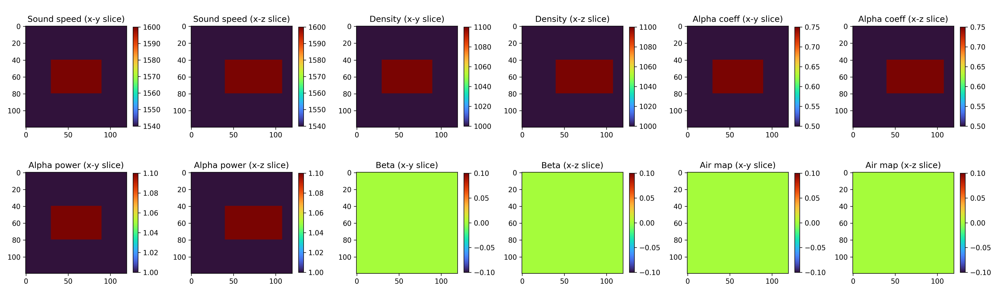</td>
        </tr>
        <tr>
          <td style="text-align: center;" >x-y slice propagation</td>
          <td style="text-align: center;" >x-z slice propagation</td>
        </tr>
        <tr>
          <td style="text-align: center;" >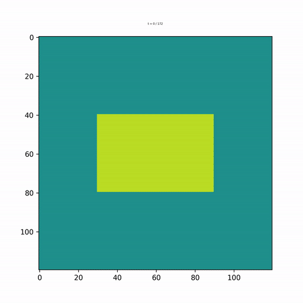</td>
          <td style="text-align: center;" >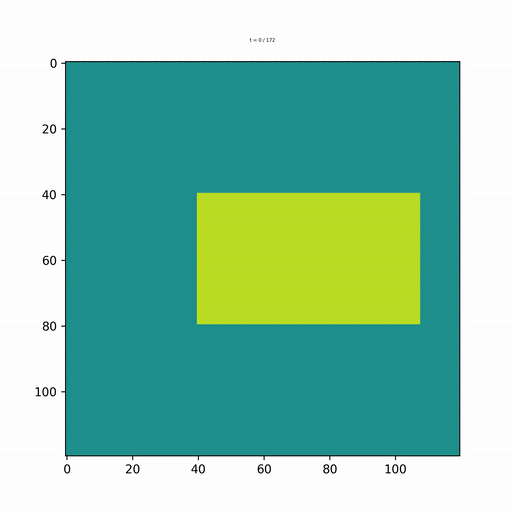</td>
        </tr>
      </table>
    - [Simple plane wave in 3D with air inclusion](https://github.com/pinton-lab/fullwave25/blob/main/examples/wave_3d/simple_plane_wave_3d_with_air.py)
      <table>
        <tr>
          <td style="text-align: center;"  colspan="2">Computational medium with air inclusion</td>
        </tr>
        <tr>
          <td style="text-align: center;"  colspan="2">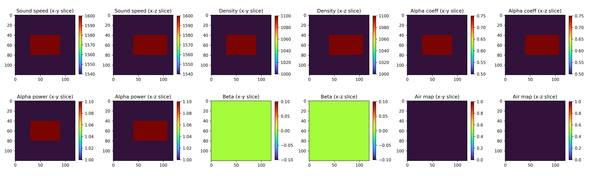</td>
        </tr>
        <tr>
          <td style="text-align: center;" >x-y slice propagation</td>
          <td style="text-align: center;" >x-z slice propagation</td>
        </tr>
        <tr>
          <td style="text-align: center;" >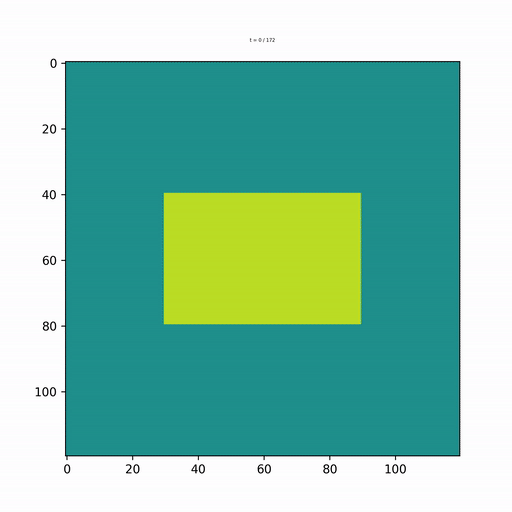</td>
          <td style="text-align: center;" >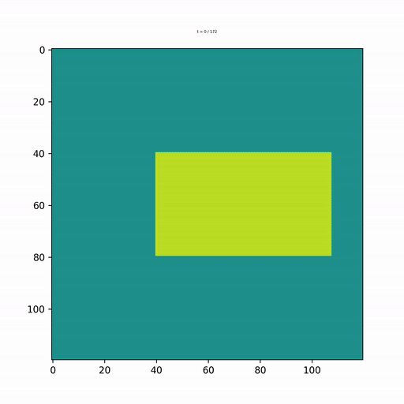</td>
        </tr>
      </table>

- Medium builder usage
  - Medium builder is a utility to create computational medium from simple geometric operations. This is especially useful when you want to create complex heterogeneous media.
  - [simple medium builder usage](https://github.com/pinton-lab/fullwave25/blob/main/examples/medium_builder/medium_builder_example.py) [](https://colab.research.google.com/drive/169aHbXRt_-aXFEdf2pfPkwH4-niJvrfL)
  - [simple medium builder usage with abdominal wall](https://github.com/pinton-lab/fullwave25/blob/main/examples/medium_builder/medium_builder_abdominal_example.py)
  - [medium builder in 3D](https://github.com/pinton-lab/fullwave25/blob/main/examples/medium_builder/medium_builder_example_3d.py)

---

## Experimental: fullwave2-ultra backend

`Solver(..., use_ultra=True)` runs the simulation with the fullwave2-ultra binary instead of the fullwave25 solver binary. It is experimental and the API may change.

The fullwave2-ultra backend is optimized for speed at ppw = 6 (`Grid.ppw`); a larger ppw runs, but more slowly, and gives a warning.

fullwave25 does not ship the fullwave2-ultra binaries. Get them from <https://github.com/pinton-lab/fullwave2-ultra> or contact the Pinton lab.

Point the solver to the binary with `path_fullwave_simulation_bin` or with the environment variable `FW2U_BATCH_BIN`. Either can be the binary file or the folder that contains it. The binary name is `bench_2d_batch` for a 2D grid and `bench_3d_opt` for a 3D grid.

```python
from pathlib import Path

import fullwave

solver = fullwave.Solver(
    work_dir=Path("./outputs/ultra"),
    grid=grid,  # 2D or 3D fullwave.Grid
    medium=medium,  # fullwave.Medium with alpha_power == 1 everywhere
    source=source,
    sensor=sensor,
    path_fullwave_simulation_bin=Path("/path/to/fullwave2-ultra/bin"),
    use_ultra=True,
)
traces = solver.run()  # (n_sensors, n_frames)
# 2D only: traces = solver.run_batch(sources)  # (n_transmits, n_sensors, n_frames)
```

In 2D, `run_batch` treats `max_members_per_run` as an upper bound that the free GPU memory can lower, and it keeps the requested value, with a warning, when the free memory cannot be read. The native path uses an explicit `max_members_per_run` as given.

Supported now:

- 2D grids with `run` and `run_batch`, including air cells.
- 3D grids with `run`, including air cells.
- Additive sources (`p0_additive`) and `source_type="soft"` in 2D and 3D.
- The three source types in 2D and 3D, as on the native path: `"hard"` holds the source cells at zero pressure after `p0` ends, `"hard_released_after"` lets them evolve freely, and `"soft"` (and `p0_additive`) add to the pressure.

`UltraUnsupportedError` is raised for:

- `run_batch` in 3D.
- Velocity sources, and sources that are not pressure sources.
- Sparse-grid sensors, `is_static_map`, and `record_whole_domain`.
- Media other than `fullwave.Medium` (exponential attenuation), and `alpha_power` other than 1.
- `use_pml=False`, `m_spatial_order` other than 8, `use_gpu=False`, and an invalid `source_type`.
- In 2D, a binary that does not read the files for air cells, for the additive channel, or for releasing the source (with such a binary, pad `p0` to `grid.nt`).
- In 3D, air cells with a binary that does not read `icczero.dat` and `nzero0.dat`, and additive sources with a binary that does not read `ncoords_add.dat` and `icmat_add.dat`.

This list will grow as the backend does.

The backend runs the exponential attenuation model (frequency-independent: the same attenuation at every frequency). Set the width of its absorbing sponge, in cells, with `ultra_sponge_thickness_px`; the default is 6 wavelengths in 2D and 4 wavelengths in 3D. `exponential_attenuation_pml_thickness_px` no longer sets this width with `use_ultra=True`; a script that relied on it now gets the default width until it passes `ultra_sponge_thickness_px`.

Options that only tune the native solver are ignored with a warning, once per process: `pml_layer_thickness_px`, `n_transition_layer`, `pml_alpha_entrance`, `exponential_attenuation_pml_thickness_px` (use `ultra_sponge_thickness_px` instead), `use_gpu_pml`, `save_gpu_memory`, `write_maps_the_solver_does_not_read`, `use_isotropic_relaxation=False`, and a `cuda_device_id` that lists more than one device (the run uses the first one listed). `use_exponential_attenuation=False`, the native default, also warns that the backend runs the exponential attenuation model, whose attenuation is frequency-independent, not the relaxation model, whose attenuation is frequency-dependent. Pass `use_exponential_attenuation=True` to silence it.

---

## Attention

- The simulation grid is defined as follows:
  - (x, y, z) = (depth, lateral, elevational).
    - This order is due to the efficiency of the multiple-GPU execution.
    - Multi-GPU domain decomposition is processed in the depth dimension.
  - The index of the input coordinates (i.e. the acoustic source location) is defined in C-array order (i.e. row-major) within the simulation, regardless of your setup. This is to improve the efficiency of multi-GPU development.
  - This might be confusing, so please be careful when you define the source and source signal definition.
- GPU memory requirement
  - A 3D simulation requires a lot of GPU memory.
    - Please reduce the grid size or use multiple GPUs if you run out of memory.
    - You can check GPU memory usage with the 'nvidia-smi' or 'nvtop' commands.
- Multi-GPU execution
  - The current implementation supports multiple GPU execution in 2D and 3D simulations.
  - Our implementation demonstrates linear performance scaling with the number of GPUs.
- Before 3D simulation:
  - If you want to run a 3D simulation, it is recommended that you start with a 2D simulation first to understand the basic usage.
  - The 3D simulation code is similar to the 2D code, but some plot functions are unavailable in 3D.
  - The 3D simulation takes longer to run, so starting with 2D will help you debug your code faster.

## Note for developers

- Contributions are welcome!
- When developing something new, please create a new branch such as `TYPE/BRANCH_NAME`.
  - TYPE can be `feature`, `bugfix`, `hotfix`, `docs`, `refactor`, `release`, `test`, or `experiment`.
  - `BRANCH_NAME` should be descriptive of the feature or fix you are working on.
  - see also: [GitHub Branching Name Best Practices](https://dev.to/jps27cse/github-branching-name-best-practices-49ei)
- Please write clear and concise commit messages.
- please see [CONTRIBUTING.md](CONTRIBUTING.md) for more details.

---

## Authors

- Masashi Sode (GitHub: [MasashiSode](https://github.com/MasashiSode))
- Gianmarco Pinton (GitHub: [gfpinton](https://github.com/gfpinton))

## Maintainers

- Masashi Sode (GitHub: [MasashiSode](https://github.com/MasashiSode))
